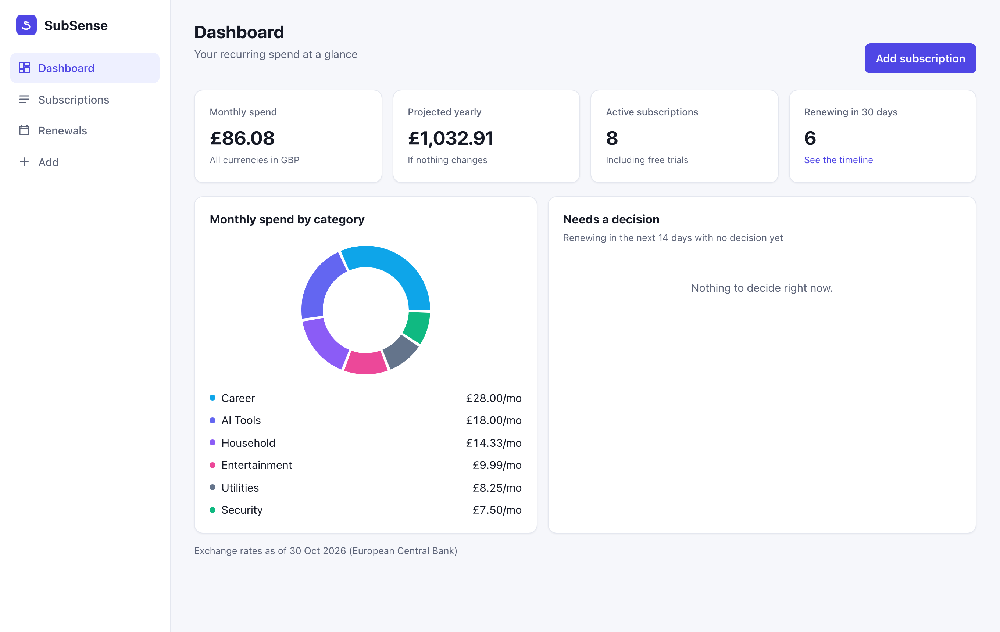
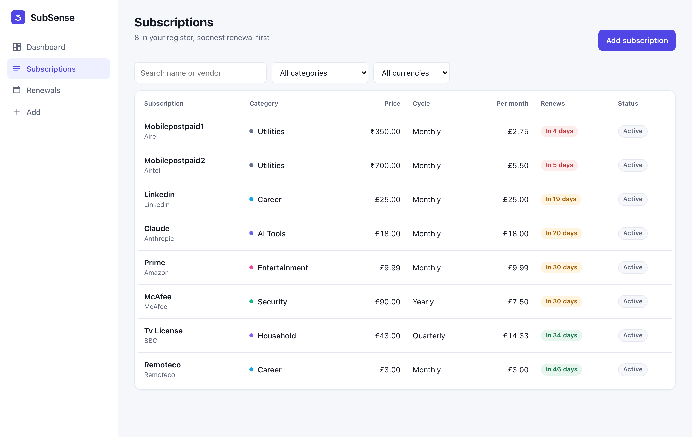
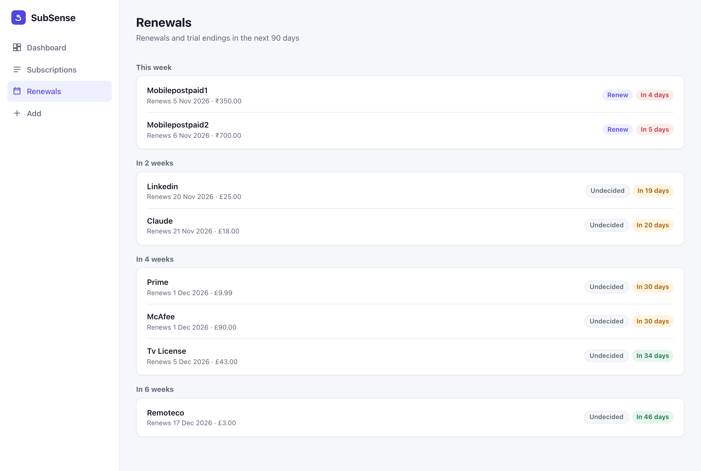
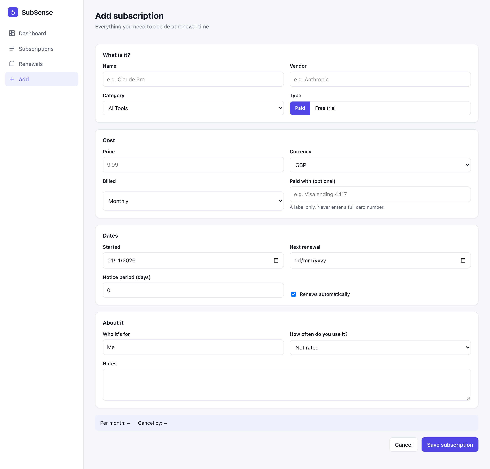
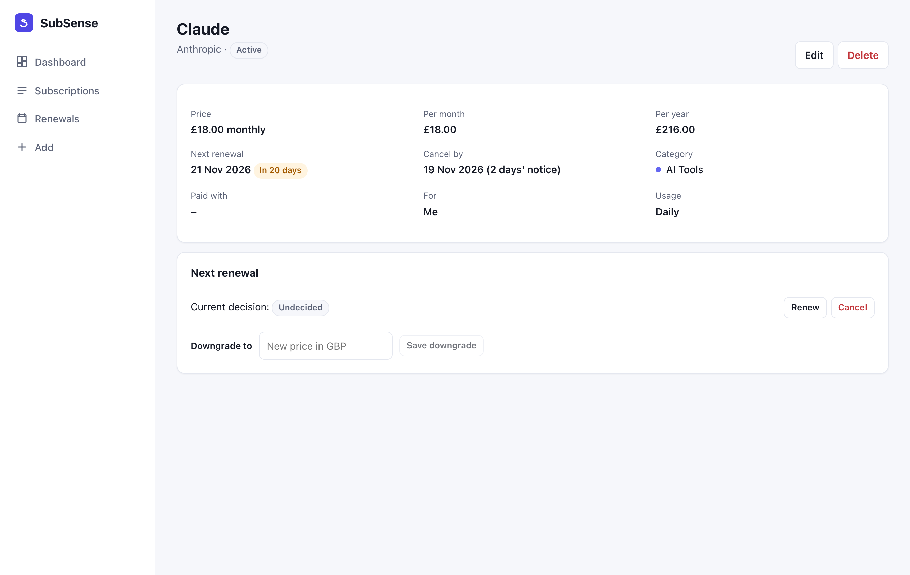
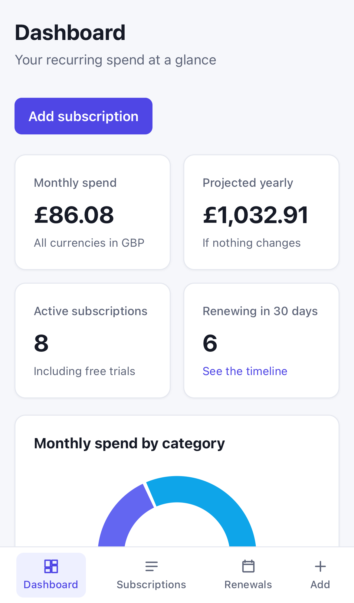
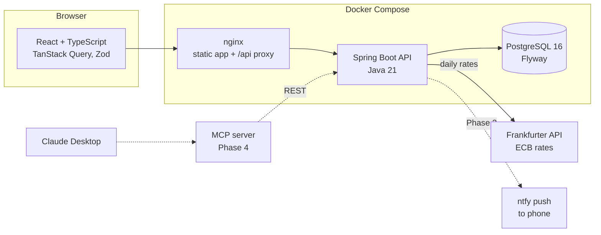

# SubSense

**A personal subscription spend manager.** One place for every recurring payment: what it costs in GBP, INR or USD, when it renews, and a deliberate renew-or-cancel decision before the money leaves your account.

[](https://github.com/OWNER/subsense/actions/workflows/ci.yml)
[](https://github.com/OWNER/subsense/actions/workflows/backend-image.yml)
[](https://github.com/OWNER/subsense/actions/workflows/frontend-image.yml)
    



## Why

I pay for AI tools, streaming, a TV licence, antivirus and mobile plans in the UK and in India. They renew on different cycles (monthly, quarterly, yearly) in three currencies, and free trials quietly turn into paid plans. Calendar reminders weren't enough: I wanted to see the real monthly total in one currency, know the last day to cancel, and record a decision for each renewal.

## Features

**Available now**

- **Subscription register:** paid plans and free trials; monthly, quarterly or yearly; notice periods and "cancel by" dates.
- **Multi-currency:** each subscription stays in its own currency (£, ₹, $ with Indian digit grouping for rupees); totals are converted to a reporting currency using daily European Central Bank rates, cached so the app works when the rate service is down.
- **Dashboard:** monthly and projected yearly spend, spend by category, and renewals in the next 14 days that still need a decision.
- **Renewal decisions:** Renew, Cancel or Downgrade, with an audit trail of who decided and when.
- **Renewals timeline:** the next 90 days grouped by week.
- **Privacy by design:** payment methods are labels only ("Visa ending 4417"); validation rejects anything that looks like a card number, in the UI, the API and the database.

**Roadmap** (full detail in [SPEC.md](SPEC.md))

| Phase | What |
|---|---|
| 2 | Renewal rollover with month-end handling, **push reminders to my phone via [ntfy](https://ntfy.sh)** (sent exactly once), budgets, "still using it?" reviews and savings tracking |
| 3 | Payment log with price-change detection, CSV import/export, calendar (.ics) feed, receipts, login |
| 4 | **Talk to my data:** an MCP server so AI clients such as Claude Desktop can answer "What renews next month, and what could I cancel?" from live data, alongside the web UI |

## Screenshots

| Subscriptions | Renewals |
|---|---|
|  |  |

| Add a subscription | Detail and decisions |
|---|---|
|  |  |

<p align="center"></p>

*Screenshots show my own subscriptions, entered through the web UI. Payment methods are not recorded.*

## Architecture



| Layer | Choices |
|---|---|
| Backend | Java 21, Spring Boot 3.5, Spring Data JPA, Bean Validation, Flyway, PostgreSQL 16, springdoc-openapi, RFC 7807 errors |
| Frontend | React 19, TypeScript (strict), Vite, React Router, TanStack Query, React Hook Form + Zod, Recharts |
| Testing | JUnit 5, AssertJ, Mockito, Testcontainers, Vitest, Testing Library, MSW, Cucumber + Playwright |
| Quality | [fmt-maven-plugin](https://github.com/spotify/fmt-maven-plugin) (google-java-format), ESLint, Prettier, JaCoCo, Dependabot |
| Delivery | Docker multi-stage builds, Docker Compose, GitHub Actions, GitHub Container Registry |

Design notes:

- **Money is never a floating-point number.** `BigDecimal` in Java, `NUMERIC(12,2)` in PostgreSQL, strings on the wire (`{"amount": "18.00", "currency": "GBP"}`), half-even rounding only when presenting.
- **Rates are stored per euro**, so any currency pair converts through EUR ([ADR 0002](docs/adr/0002-exchange-rates.md)).
- **One injected `Clock`** decides "today" in the user's time zone, so date rules are testable.
- **Package by feature** (`subscription`, `currency`, `dashboard`); `BillingCycle` owns its own cost maths; the dashboard is a pure function of subscriptions, rates and today.
- Design follows SOLID, DRY, KISS and YAGNI; trade-offs are recorded in [docs/adr](docs/adr).

## Run it

### With Docker (everything)

Requires Docker.

```bash
git clone https://github.com/OWNER/subsense.git
cd subsense
docker compose up --build
```

- App: http://localhost:3000
- API docs (Swagger UI): http://localhost:8080/swagger-ui.html
- Health: http://localhost:8080/actuator/health

### For development

Requires Java 21, Maven 3.9, Node 22 and Docker (for PostgreSQL and integration tests).

```bash
# 1. Database
docker compose up -d postgres

# 2. Backend on :8080 (applies Flyway migrations on start)
cd backend
mvn spring-boot:run

# 3. Frontend on :5173 (proxies /api to :8080)
cd frontend
npm install
npm run dev
```

UI only, no backend: `npm run dev:mock` serves the app with sample data from a mock service worker.

### Configuration

| Variable | Default | Purpose |
|---|---|---|
| `DB_URL` / `DB_USERNAME` / `DB_PASSWORD` | `jdbc:postgresql://localhost:5432/subsense` / `subsense` / `subsense` | Database |
| `SUBSENSE_REPORTING_CURRENCY` | `GBP` | Currency for totals (`GBP`, `INR`, `USD`) |
| `SUBSENSE_TIME_ZONE` | `Europe/London` | Defines "today" for renewal dates |
| `SUBSENSE_FX_BASE_URL` | `https://api.frankfurter.dev/v1` | Exchange rate service |
| `SUBSENSE_FX_REFRESH_CRON` | `0 0 6 * * *` | When rates refresh |

Copy `.env.example` to `.env` to override them for Docker Compose.

## Tests

```bash
# Backend: format check, unit tests, Testcontainers integration tests, coverage report
mvn -pl backend verify

# Frontend: lint, types, unit and component tests
cd frontend && npm run lint && npm run typecheck && npm test

# End-to-end: Cucumber scenarios in a real browser against the full stack, with fixed exchange rates
SUBSENSE_FX_BASE_URL=http://fx-stub:8080 docker compose --profile e2e up -d --build --wait
mvn -pl e2e test-compile exec:java -Dexec.classpathScope=test \
  -Dexec.mainClass=com.microsoft.playwright.CLI -Dexec.args="install chromium"   # first run only
mvn -pl e2e verify                                   # all scenarios
mvn -pl e2e verify -Dcucumber.filter.tags="@F-02"    # one feature
```

Each acceptance criterion in [SPEC.md](SPEC.md) maps to a Cucumber scenario tagged with its feature ID, for example:

```gherkin
@F-02
Scenario: Spend in rupees and dollars is totalled in pounds
  Given a "Monthly" subscription "Netflix" costing "10.00" "GBP" renewing in 20 days
  And a "Monthly" subscription "Mobile plan" costing "900.00" "INR" renewing in 20 days
  And a "Monthly" subscription "ChatGPT Plus" costing "11.00" "USD" renewing in 20 days
  When I open the dashboard
  Then monthly spend is "£27.00"
```

Java formatting is enforced in the build. Fix it with `mvn -pl backend com.spotify.fmt:fmt-maven-plugin:format`.

## CI/CD

| Workflow | Trigger | What it does |
|---|---|---|
| [CI](.github/workflows/ci.yml) | Every PR and push to `main` | `backend`: format check, unit and integration tests, JaCoCo. `frontend`: Prettier, ESLint, type check, tests, build. `e2e`: starts the Compose stack and runs the Cucumber suite, uploading the HTML report |
| [Backend image](.github/workflows/backend-image.yml) | Changes under `backend/` | Builds the image on PRs; pushes `ghcr.io/OWNER/subsense-backend` from `main` (`latest`, `sha-…`) and from tags (`v1.2.3`) |
| [Frontend image](.github/workflows/frontend-image.yml) | Changes under `frontend/` | Same for `ghcr.io/OWNER/subsense-frontend` (nginx serving the built app) |

`main` is protected: changes arrive through pull requests, and the `backend`, `frontend` and `e2e` checks must pass before merging.

## How I build it: AI-assisted, test-driven

I use AI tooling (Claude Code) as a standard part of every stage, with a human decision at each step:

| Stage | AI does | I decide |
|---|---|---|
| Design | `/plan-feature F-xx` drafts a plan from the spec: API, schema, edge cases, test list ([example](docs/features/F-01-04-core-register.md)) | Approve or change the plan before any code |
| Acceptance tests | Turns acceptance criteria into Gherkin and suggests edge cases (month ends, leap years, rounding, time zones) | Keep the scenarios that matter |
| Implementation | `/tdd F-xx` works in red-green-refactor cycles, running the formatter and tests each step | Review every diff |
| Code review | `/review-pr` checks the branch against the spec and [CLAUDE.md](CLAUDE.md): correctness, tests, security, money and date handling, SOLID/DRY/KISS/YAGNI | Fix or reject findings; CI must be green |
| Debugging | Reads logs and proposes a root cause with a failing test that reproduces it | Confirm the root cause |

The rules the agent follows live in [CLAUDE.md](CLAUDE.md), the commands in [.claude/commands](.claude/commands), and every pull request records how AI was used ([template](.github/pull_request_template.md)).

## Project layout

```
subsense/
├── backend/            Spring Boot API (Maven), Flyway migrations, Dockerfile
├── frontend/           React + TypeScript (Vite), nginx config, Dockerfile
├── e2e/                Cucumber + Playwright scenarios, WireMock rate stub
├── docs/
│   ├── adr/            Architecture decision records
│   ├── features/       Feature plans written before implementation
│   └── screenshots/
├── .claude/commands/   AI workflow commands: plan-feature, tdd, review-pr
├── .github/            CI/CD workflows, PR template, Dependabot
├── docker-compose.yml
├── SPEC.md             Product and technical specification
└── CLAUDE.md           Instructions for the AI coding agent
```

## License

[MIT](LICENSE)
